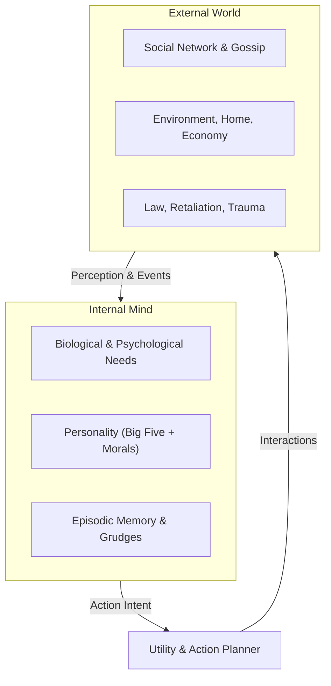
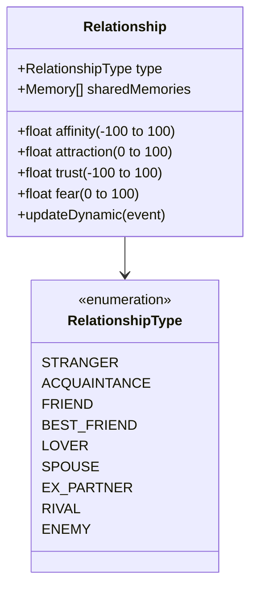
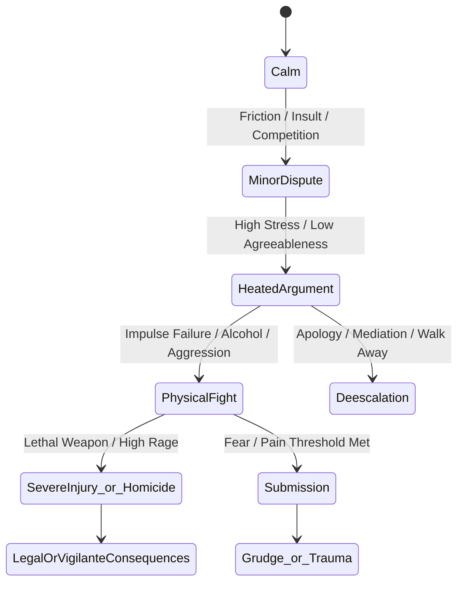
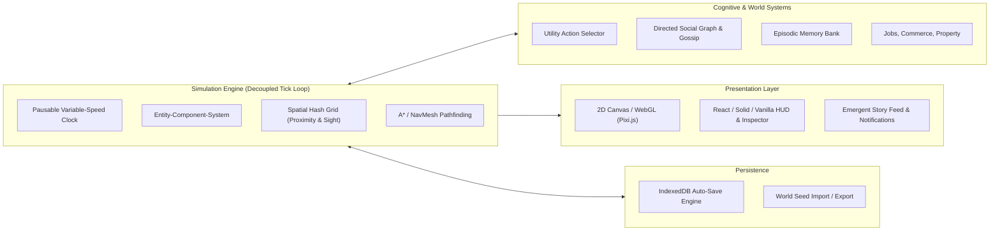
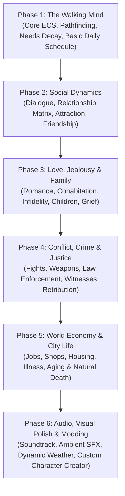

# Project Blueprint: "Humanity Sandbox" (Emergent Life Simulator)

An open-ended, web-based emergent human life simulator exploring psychology, social dynamics, intimacy, morality, conflict, and consequence.

---

## 1. Vision & Core Philosophy

### 1.1 The Premise
Unlike traditional games with victory conditions, **Humanity Sandbox** has no game-over screen and no high score. It is a living canvas where human beings live out their lives according to biological drives, psychological traits, social conditioning, and environmental pressures. 

Players can experience the simulation in two complementary modes:
1. **The Protagonist Mode**: Live inside the world as one distinct human, navigating relationships, stress, temptations, and survival.
2. **The Overseer Mode**: Observe an autonomous neighborhood or town, nudging environments, introducing crises, or watching emergent human drama unfold.

### 1.2 Guiding Pillars
- **Radical Emergence**: Stories are not pre-written; they emerge from the intersection of desires, memories, personality traits, and situational triggers.
- **Action & Consequence**: Violence is never consequence-free. Love is fragile. Actions leave lasting psychological marks (trauma, guilt, grudges, loyalty).
- **Nuanced Morality**: There are no purely "evil" or "good" NPCs. Desperation breeds theft; trauma breeds isolation or aggression; empathy breeds self-sacrifice.
- **Full Life Arc**: Birth, childhood influences, passionate youth, mid-life crises, elder wisdom, and natural or tragic death.



---

## 2. Agent Psychology & Decision Engine

Every human agent in the simulation operates on a tripartite cognitive architecture: **Drives**, **Personality**, and **Episodic Memory**.

### 2.1 Needs & Drives (Dynamic States: 0 - 100)
When drives fall into critical zones (<20), they trigger acute mental stress and prioritize survival/relief behaviors.

| Need Category | Attribute | Effect of Depletion | Satisfaction Vector |
| :--- | :--- | :--- | :--- |
| **Physiological** | Energy | Exhaustion, fainting, impaired impulse control | Sleep, rest, coffee |
| | Hunger | Malnutrition, starvation, desperation | Cooking, dining, foraging, stealing |
| | Health / Safety | Shock, agony, fear response | Medical care, bandages, safe shelters |
| **Psychological** | Social Connection | Loneliness, depression, paranoia | Conversation, bonding, communal gatherings |
| | Fun / Stimulation | Boredom, apathy, reckless novelty-seeking | Hobbies, games, reading, entertainment |
| | Purpose / Esteem | Existential dread, self-loathing | Work achievements, art, raising children, status |
| | Comfort / Environment | Agitation, sensory overload | Clean spaces, quiet, aesthetic surroundings |

### 2.2 Personality Matrix: The Big Five + Moral Traits
Each agent is seeded with immutable core traits (scaled -1.0 to +1.0) and malleable moral values:

- **Openness**: High = artistic, curious, open to unconventional relationships; Low = traditional, cautious.
- **Conscientiousness**: High = disciplined, law-abiding, hardworking; Low = impulsive, chaotic, negligent.
- **Extraversion**: High = seeks crowds, energized by socialization; Low = solitary, drained by social gatherings.
- **Agreeableness**: High = empathetic, forgiving, trusting; Low = cynical, confrontational, ruthless.
- **Neuroticism**: High = volatile, anxious, vulnerable to depression/rage; Low = emotionally resilient, stoic.
- **Morality Anchors**:
  - *Aggression Bias*: Propensity to resolve disputes with force.
  - *Empathy Factor*: Psychological distress experienced when witnessing or causing harm.
  - *Impulse Control*: Ability to suppress high-risk urges (theft, assault, infidelity) under stress.

### 2.3 The Episodic Memory & Grudge System
Agents do not react only to the present; they maintain an internal memory log:
```typescript
interface Memory {
  id: string;
  timestamp: number;
  subjectId: string;       // Who did it
  actionType: string;      // e.g., 'HELPED_IN_CRISIS', 'BETRAYED_TRUST', 'ASSAULTED'
  emotionalWeight: number; // Positive or negative (-100 to +100)
  decayRate: number;       // Forgetting speed over time
  traumaFlag: boolean;     // Traumatic memories decay much slower or resurface
}
```

---

## 3. Social Fabric: Love, Kinship & Rivalry



### 3.1 Directed Relationship Graph
Relationships are directional. **Alice may deeply love Bob (Attraction: 85, Affinity: 90), while Bob merely tolerates Alice (Attraction: 15, Affinity: 20).**

Key Relationship Vectors:
- **Affinity** (-100 to 100): Platonic liking vs hatred.
- **Attraction** (0 to 100): Physical and romantic desire.
- **Trust** (-100 to 100): Belief in reliability, honesty, and safety.
- **Fear** (0 to 100): Perceived threat of violence or ruin.

### 3.2 Love & Romance Dynamics
1. **Courtship & Chemistry**: Calculated using shared interests, complementary personality traits, and physical appeal.
2. **Commitment & Marriage**: Deep emotional bonding creates dependency, shared living arrangements, and vulnerability.
3. **Jealousy & Infidelity**: High neuroticism + low conscientiousness + opportunity can lead to infidelity. If discovered by a partner:
   - High agreeableness $\rightarrow$ Grief, withdrawal, attempted reconciliation.
   - Low agreeableness + high neuroticism $\rightarrow$ Explosive confrontation, physical violence, property damage, revenge plots.
4. **Heartbreak & Grief**: Loss of a lover or child triggers an acute grief state (severely elevated neuroticism, loss of appetite, insomnia, isolation).

### 3.3 Gossip & Reputation Network
Information spreads organically through speech:
- When Alice witnesses Bob stealing, Alice's trust in Bob drops.
- When Alice talks to Charlie, she shares: `"Did you know Bob is a thief?"`
- Charlie updates Bob's social reputation score in his own mind without needing to witness the act directly.

---

## 4. Conflict, Violence & Justice

Violence is not an arcade mechanic; it is an organic boiling point of stress, fear, greed, or passion.

### 4.1 The Conflict Escalation Ladder


### 4.2 Violence Vectors
1. **Impulsive Violence (Brawling & Rage)**:
   - Occurs during explosive arguments, alcohol intoxication, or jealous rage.
   - Unarmed or improvised weapons (bottles, chairs, fists).
   - High post-action remorse in empathetic characters.
2. **Premeditated Violence (Crime & Vendettas)**:
   - Cold, planned attacks motivated by money (mugging/burglary) or revenge (avenging a murdered family member).
   - Weapons utilized deliberately.
3. **Domestic / Intimate Violence**:
   - Power dynamics, control, and toxic relationship escalation.

### 4.3 Injury & Mortality
- Detailed bodily conditions: Bruises, lacerations, broken bones, concussions, blood loss, internal trauma.
- Characters can survive with permanent disabilities, facial scars, chronic pain, or psychological PTSD.

### 4.4 Justice & Consequences
1. **Social Punishment**: Ostracization, refusal of businesses to serve the offender, public shaming, abandonment by friends.
2. **Legal Enforcement**: Law enforcers / police investigate crime scenes, interview witnesses, arrest suspects, and impose jail sentences or forced labor.
3. **Vigilante Retribution**: In lawless or corrupt settings, victims' relatives hunt down offenders, initiating multigenerational blood feuds.

---

## 5. Technical Architecture (Web Platform)



### 5.1 Tech Stack Recommendation
- **Runtime**: Web Browser (Desktop & Mobile responsive).
- **Core Language**: TypeScript (strict types for robust simulation physics and mental states).
- **Render Engine**: **Pixi.js v8** (Fast 2D WebGL rendering with canvas fallback, ideal for high entity counts, animated sprites, mood bubbles, and atmospheric lighting) or **Phaser 3**.
- **UI Framework**: Modern lightweight reactive UI (e.g. Preact or Tailwind CSS + Vanilla DOM) for the Inspector, Relationship Tree, and Event Ticker to keep framerates locked at 60 FPS while the simulation ticks in the background.
- **State Management**: Entity-Component-System (ECS) pattern (`bitecs` or clean custom lightweight ECS) allowing thousands of simultaneous NPC calculations.
- **Storage**: IndexedDB for continuous autosaving of world state, character bios, and genealogy trees.

### 5.2 Decoupled Loop
- **Render Loop**: 60 FPS requestAnimationFrame for smooth camera panning, animations, particle effects, and day-to-night lighting.
- **Simulation Tick**: 1 tick = 1 game minute. Controllable speed:
  - Pause (0x)
  - Normal (1 min/sec)
  - Fast (5 min/sec)
  - Hyper (30 min/sec)

---

## 6. User Interface & Player Agency

### 6.1 Viewport & Presentation
- **Perspective**: 2D Top-down or Isometric view of a vibrant living neighborhood (apartments, bars, parks, grocery stores, hospital, police precinct, alleys).
- **Visual Feedback**:
  - Emote bubbles above heads (heart for flirting, exclamation for fear, broken heart for rejection, fist for rage, thought bubbles for current desires).
  - Lighting cycles (dawn, bright noon, dusk, streetlights at night, storms).
  - Physical indicators (blood stains on ground, bandages on injured characters, disheveled clothes when exhausted).

### 6.2 The Deep Inspector
Clicking on any human reveals their full inner life:
- **Bio & Vitals**: Age, health status, current job, financial balance, current activity.
- **Psychological Gauge**: Needs bars (Hunger, Energy, Social, Fun, Purpose).
- **Mind Thoughts**: Real-time internal monologue (e.g., *"I can't stand the way David looks at Maria. I want to smash something."*).
- **Relationship Web**: Interactive graph showing everyone they know, colored by love, hate, or fear.
- **Memory Timeline**: Chronological log of significant life moments.

### 6.3 Player Agency Modes
- **Puppeteer Mode**: You direct your chosen human's actions (move here, talk to X, pick a fight, flirt, study, steal), with your character's personality providing resistance (e.g. asking a gentle soul to murder will trigger intense psychological pushback).
- **God / Observer Mode**: Free camera. You can observe anyone, alter environmental factors (cut power, set a fire, drop a pile of cash on a bench, trigger an economic depression) and watch human nature react.
- **Possession Mode**: Seamlessly switch control to any character in the town at any second.

---

## 7. Phased Implementation Roadmap



---

## 8. Immediate Next Steps
To begin code implementation, we will establish:
1. **Project Scaffold**: Vite + TypeScript modern web app.
2. **Core Simulation Loop**: Tick clock, spatial grid, entity management.
3. **First 5 Test Citizens**: Placed in an interactive test environment to test social mingling, emotional drift, and emergent conflict.
